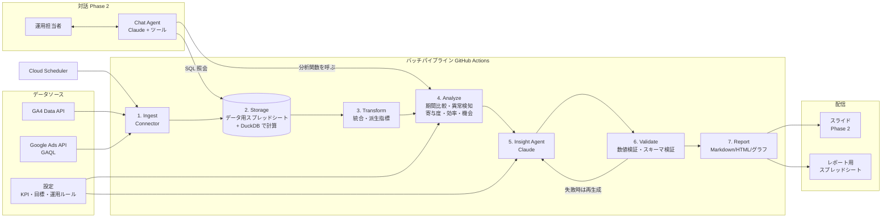
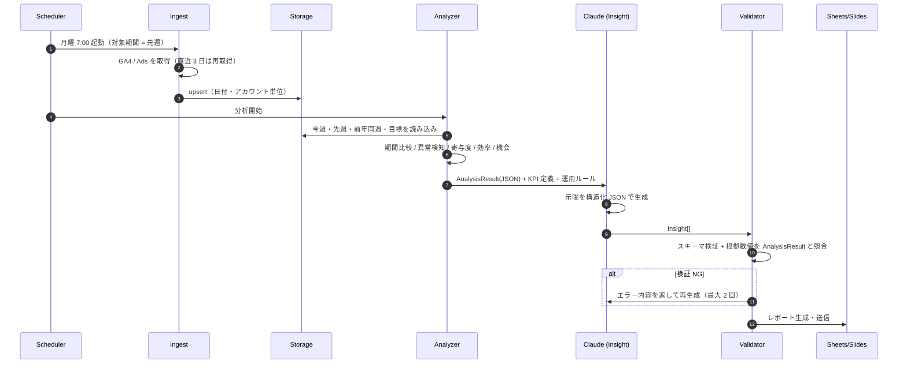

# 02. システム設計書（アーキテクチャ）

## 1. 設計方針

1. **数値はコード、言葉は AI**: 取得・集計・統計処理はすべて Python の決定的なコードで行う。Claude は「分析結果の解釈・示唆・文章化」と「対話時のツール選択」だけを担当する
2. **読み取り専用**: Phase 1 は Google API の書き込み権限を持たない
3. **パイプラインは段階ごとに分離**: 取得 → 保存 → 分析 → 示唆 → 配信。各段の出力を保存し、どこからでも再実行できる（冪等）
4. **データソースはプラグイン化**: `Connector` インターフェースを実装すれば媒体を追加できる

## 2. 全体構成図



## 3. 処理フロー（週次レポート）



## 4. 技術スタック

| レイヤ          | 採用技術（推奨）                                                                            | 理由 / 代替案                                                                                      |
| --------------- | ------------------------------------------------------------------------------------------- | -------------------------------------------------------------------------------------------------- |
| 言語            | Python 3.12                                                                                 | Google 公式クライアントとデータ分析ライブラリが揃っている                                          |
| GA4 取得        | `google-analytics-data`（GA4 Data API v1beta）                                              | 代替: GA4 BigQuery エクスポート                                                                    |
| Google 広告取得 | `google-ads`（公式 Python クライアント、GAQL）                                              | 代替: BigQuery Data Transfer Service                                                               |
| 保存            | **データ用スプレッドシート**（取得データ・示唆ログ）。計算時は DuckDB（メモリ上）に読み込む | BigQuery は未使用。データ量が増えたら Drive 上の Parquet や BigQuery に移せるよう Storage を抽象化 |
| 分析            | pandas、numpy、statsmodels（STL 分解は Phase 2）                                            |                                                                                                    |
| AI              | **Claude Agent SDK（Python）** / Anthropic Messages API                                     | ツール呼び出し・構造化出力・プロンプトキャッシュ                                                   |
| モデル          | 週次・日次: `claude-sonnet-5-5`、月次の深掘り: `claude-opus-5-5`                            | コストと品質のバランスで設定ファイルから切り替え                                                   |
| 検証            | pydantic（スキーマ）、独自の数値照合                                                        |                                                                                                    |
| グラフ          | matplotlib / plotly（PNG 出力）                                                             |                                                                                                    |
| 出力            | Google Sheets API（表・ネイティブグラフ）、Google Slides API（Phase 2）                     | `04_reporting-design.md` 参照                                                                      |
| 実行基盤        | GitHub Actions（cron）を MVP の既定案とする                                                 | 比較は `05_repository-and-runtime.md`                                                              |
| 秘密情報        | GitHub Actions Secrets（環境変数経由で注入）                                                | GCP に移す場合は Secret Manager                                                                    |
| 監視            | Actions の実行ログ ＋ 失敗時のメール通知                                                    |                                                                                                    |

### データ取得方式の比較

| 方式                            | 長所                                   | 短所                                          | 推奨条件                             |
| ------------------------------- | -------------------------------------- | --------------------------------------------- | ------------------------------------ |
| A. API 直接取得                 | 追加設定が少ない。必要な粒度だけ取れる | API クォータ、GA4 のしきい値・サンプリング    | **MVP（既定）**                      |
| B. BigQuery エクスポート / 転送 | 生データで柔軟。クォータの心配が少ない | GA4 イベント単位で SQL が重い。初期設定が必要 | 既に GCP / BigQuery を使っている場合 |

`Connector` を抽象化しておき、A で始めて B に差し替えられるようにする。

## 5. ディレクトリ構成（実装予定）

```text
ads-analytics-agent/
├── pyproject.toml
├── config/
│   ├── accounts.yaml        # GA4 プロパティ ID、Ads カスタマー ID
│   ├── kpi.yaml             # KPI 定義、目標値、月予算
│   └── playbook.md          # 運用ルール・業界知識（示唆生成に渡す）
├── src/ads_agent/
│   ├── connectors/
│   │   ├── base.py          # Connector インターフェース
│   │   ├── ga4.py
│   │   └── google_ads.py
│   ├── storage/             # Sheets / DuckDB アダプタ（将来 Parquet・BigQuery）
│   ├── transform/           # 結合・派生指標
│   ├── analysis/
│   │   ├── period_compare.py
│   │   ├── anomaly.py
│   │   ├── decomposition.py # 寄与度分解・CPA 要因分解
│   │   ├── efficiency.py    # 無駄な費用
│   │   ├── opportunity.py   # 予算制限・高効率セグメント
│   │   └── tracking_health.py
│   ├── insights/
│   │   ├── schema.py        # Insight / AnalysisResult（pydantic）
│   │   ├── prompts/
│   │   ├── generator.py     # Claude 呼び出し
│   │   └── validator.py     # 数値照合
│   ├── report/              # テンプレート、グラフ、配信
│   ├── chat/                # 対話エージェント（Phase 2）
│   └── cli.py               # `ads-agent run weekly --date 2026-11-02`
├── tests/                   # 分析ロジックの単体テスト、固定データの回帰テスト
└── docs/                    # 本設計書
```

## 6. データモデル

BigQuery を使わないため、以下の各テーブルは **データ用スプレッドシートのタブ** として保存する（1 シート 1,000 万セルまで）。容量を抑えるため、検索語句は週単位に集計して保存し、日次の明細は必要なときに API から取り直す。

### 6.1 取得テーブル（raw）

| テーブル                    | 粒度（主キー）                                                                                 | 主な列                                                                                                                                                     |
| --------------------------- | ---------------------------------------------------------------------------------------------- | ---------------------------------------------------------------------------------------------------------------------------------------------------------- |
| `raw_ga4_daily`             | date, property_id, session_source_medium, session_campaign_name, landing_page, device_category | sessions, total_users, engaged_sessions, key_events, purchase_revenue                                                                                      |
| `raw_ga4_events_daily`      | date, property_id, event_name, session_campaign_name                                           | event_count, key_events                                                                                                                                    |
| `raw_ads_campaign_daily`    | date, customer_id, campaign_id, device                                                         | impressions, clicks, cost, conversions, conversions_value, search_impression_share, search_budget_lost_impression_share, search_rank_lost_impression_share |
| `raw_ads_keyword_daily`     | date, customer_id, ad_group_id, criterion_id                                                   | keyword_text, match_type, quality_score, impressions, clicks, cost, conversions                                                                            |
| `raw_ads_search_term_daily` | date, customer_id, ad_group_id, search_term                                                    | impressions, clicks, cost, conversions                                                                                                                     |

### 6.2 統合マート

| テーブル              | 内容                                                                                           |
| --------------------- | ---------------------------------------------------------------------------------------------- |
| `mart_campaign_daily` | 広告データ ＋ GA4（`session_campaign_name` で結合）＋ 派生指標（CTR / CPC / CVR / CPA / ROAS） |
| `mart_channel_daily`  | GA4 のデフォルトチャネルグループ別（広告以外の流入も含む全体像）                               |
| `mart_kpi_daily`      | 全体 KPI と目標値・予算消化ペース                                                              |

### 6.3 出力（履歴保存）

| テーブル           | 内容                                                                                           |
| ------------------ | ---------------------------------------------------------------------------------------------- |
| `analysis_results` | 実行 ID ごとの AnalysisResult（JSON）                                                          |
| `insights`         | 実行 ID、示唆 ID、カテゴリ、優先度、根拠、ステータス（未対応 / 実行済み / 却下）、効果測定結果 |
| `run_log`          | 実行日時、対象期間、モデル名、トークン数、検証結果                                             |

## 7. 主要インターフェース

```python
class Connector(Protocol):
    name: str
    def fetch(self, start: date, end: date) -> dict[str, pd.DataFrame]: ...

class Analyzer(Protocol):
    name: str
    def run(self, ctx: AnalysisContext) -> list[Finding]: ...

class Finding(BaseModel):          # 分析の事実（コードが生成）
    id: str                        # 例: "anomaly.cost_spike.campaign_123"
    kind: Literal["change", "anomaly", "waste", "opportunity", "tracking", "pacing"]
    scope: dict[str, str]          # {"campaign": "ブランド_検索"} など
    metrics: dict[str, float]      # {"cost": 120000, "cost_prev": 60000, ...}
    period: tuple[date, date]
    impact_jpy: float | None       # 円換算の影響額（推定）
    severity: float                # 0〜1

class Insight(BaseModel):          # 示唆（Claude が生成）
    title: str
    observation: str               # 事実
    hypothesis: str                # 解釈・原因仮説
    action: str                    # 打ち手（具体的に）
    expected_impact: str           # 期待効果
    evidence_finding_ids: list[str]  # 根拠の Finding.id（必須・1 件以上）
    cited_numbers: dict[str, float]  # 文中で使った数値（検証対象）
    confidence: Literal["high", "medium", "low"]
    effort: Literal["low", "medium", "high"]
    priority: int                  # 1 が最優先
```

## 8. 対話エージェント（Phase 2）のツール

Claude Agent SDK のカスタムツールとして公開する。すべて読み取り専用。

| ツール                                                    | 内容                                              |
| --------------------------------------------------------- | ------------------------------------------------- |
| `get_kpi_summary(period, compare_to)`                     | KPI の期間比較表                                  |
| `query_metrics(dimensions, metrics, filters, period)`     | マートに対する定型クエリ（任意 SQL は許可しない） |
| `decompose_change(metric, dimension, period, compare_to)` | 寄与度分解                                        |
| `find_anomalies(period, scope)`                           | 異常検知                                          |
| `list_wasted_spend(period, min_cost)`                     | 無駄な費用の一覧                                  |
| `get_past_insights(status)`                               | 過去の示唆と効果                                  |

## 9. セキュリティ・運用

- 認証: GA4 はサービスアカウント（プロパティの閲覧者権限）、Google 広告は OAuth リフレッシュトークン ＋ 開発者トークン。すべて GitHub Actions Secrets
- LLM に送るのは集計済み数値とキャンペーン名のみ。個人情報は送らない
- 失敗時: リトライ → メール（または Slack）に通知（どの段で失敗したか、再実行コマンド）
- 再実行: `ads-agent run weekly --date YYYY-MM-DD` で任意の期間を再生成できる
- コスト管理: 実行ごとのトークン数を `run_log` に記録。月額の上限を設定ファイルに持ち、超えたら Sonnet のみに切り替える
