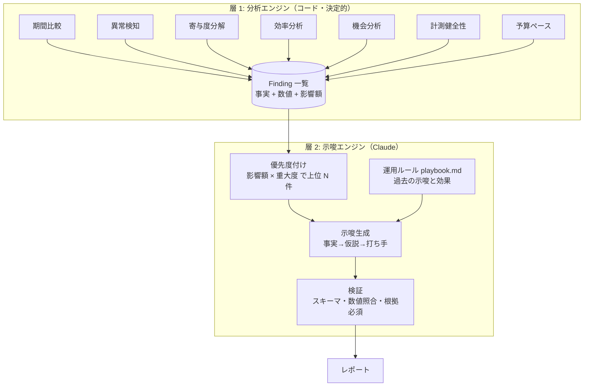

# 03. 分析ロジック・示唆出し設計

「細かい分析結果を基にした示唆出し」を実現するための詳細設計。

## 1. 2 層構造



層 1 が「何が起きたか」を正確に出し、層 2 が「なぜ・どうするか」を考える。Claude には Finding にない数値を使わせない。

## 2. 分析モジュール詳細

### 2.1 期間比較（period_compare）

- 比較軸: 前日 / 前週同曜日 / 前週 / 前月 / 前年同期
- 指標ごとに差分・変化率を算出し、**統計的に意味のある変化だけ** Finding にする
    - 件数系（CV など）: 少数のブレを除くため、ポアソン近似で有意性を判定（p < 0.05）かつ変化率 ±15% 以上
    - 費用系: 変化率 ±20% 以上かつ差額が設定値（例: 1 万円）以上

### 2.2 異常検知（anomaly）

- ベースライン: 過去 28 日の **同曜日** の中央値と MAD（中央絶対偏差）
- ロバスト z = (当日値 − 中央値) / (1.4826 × MAD)。|z| ≥ 3 を異常とする
- 対象: キャンペーン別の費用・クリック・CV・CVR、サイト全体のセッション・CV
- 特別ルール:
    - CV が 2 日以上連続で 0（過去平均 ≥ 3 件/日）→ **計測停止の疑い**（最優先）
    - 費用が日予算の 2 倍以上 → 予算設定ミスの疑い

### 2.3 寄与度分解（decomposition）

- **加法分解**: 全体の変化量 = Σ セグメントの変化量。キャンペーン / デバイス / チャネル / LP の各軸で、変化の何 % をどのセグメントが説明するかを算出
- **CPA の要因分解**（対数分解）:
    - CPA = CPC ÷ CVR なので、ln(CPA₁/CPA₀) = ln(CPC₁/CPC₀) − ln(CVR₁/CVR₀)
    - 「CPA 悪化の 70% は CVR 低下、30% は CPC 上昇」のように分ける
- **ミックス効果 vs レート効果**: 全体 CVR の変化を「配分の変化（安いキャンペーンに寄った）」と「各キャンペーンの CVR 自体の変化」に分ける

### 2.4 効率分析（efficiency）＝ 無駄な費用

| ルール                  | 判定                                                         |
| ----------------------- | ------------------------------------------------------------ |
| CV ゼロの検索語句       | 期間内費用 ≥ 目標 CPA × 1.0 かつ CV = 0 → 除外キーワード候補 |
| 高 CPA キーワード       | CPA ≥ 目標 × 1.5 かつクリック ≥ 30                           |
| 低品質スコア            | 品質スコア ≤ 4 かつ費用上位 20%                              |
| 曜日・時間帯 / デバイス | CPA が全体平均の 1.5 倍以上のセグメント → 入札調整候補       |

影響額 = 削減できる費用の推定（過去 N 日の費用 × 期間換算）。

### 2.5 機会分析（opportunity）

| ルール                       | 判定                                                            |
| ---------------------------- | --------------------------------------------------------------- |
| 予算制限の高効率キャンペーン | ROAS ≥ 目標 かつ 予算による IS 損失 ≥ 10% → 増額候補            |
| 掲載順位による損失           | 順位による IS 損失 ≥ 20% かつ CVR 高 → 入札・広告品質の改善候補 |
| 高 CVR の検索語句            | 未登録の検索語句で CV ≥ 2 → キーワード追加候補                  |
| 高 CVR の LP                 | 同じ流入元で CVR が他 LP の 1.5 倍以上 → 配信先 LP の変更候補   |

影響額 = 追加で得られる CV × 平均 CV 価値（または目標 CPA）。

### 2.6 計測健全性（tracking_health）

- GA4 CV と広告 CV の比率が過去 4 週の平均から ±30% 以上ずれた
- `(not set)` / `(direct)` 比率の急増、UTM の欠落したキャンペーン
- いずれも「データの前提が崩れている」ため、他の示唆より優先して出す

### 2.7 予算ペース（pacing）

- 月次着地予測 = 当月累計費用 + 直近 7 日平均 × 残日数
- 予算に対して ±10% 以上ずれる見込みなら Finding

## 3. 優先度付け

```text
score = impact_jpy の正規化値 × 0.5
      + severity                × 0.3
      + 実行容易性（effort の逆数）× 0.2
```

- 計測健全性の Finding は常に最上位
- Claude に渡すのは上位 15 件程度（トークン節約と焦点化）。Claude は最終的に 3〜5 件の示唆にまとめる（関連する Finding は 1 つの示唆に統合してよい）

## 4. 示唆生成プロンプト設計

### 4.1 システムプロンプト（要旨）

```text
あなたは経験 10 年の広告運用コンサルタントです。
入力の Findings（コードで算出済みの事実）だけを根拠に、改善の示唆を作ります。

ルール:
1. Findings にない数値を作らない。計算もしない（必要な数値は Findings に入っている）。
2. 各示唆は「事実 → 原因仮説 → 具体的な打ち手 → 期待効果 → 確度」で書く。
3. 打ち手は管理画面で実行できる粒度にする（どのキャンペーンの何をいくつ変えるか）。
4. 原因仮説が複数ありうるときは、確かめ方（追加で見るべき指標）も書く。
5. playbook（運用ルール）に反する打ち手は出さない。
6. 過去の示唆で「却下」されたものと同じ提案は繰り返さない。
7. 出力は指定の JSON スキーマに従う。
```

### 4.2 入力（ユーザーメッセージ）

1. 対象期間・比較期間
2. KPI サマリ表（実績・前期・目標・達成率）
3. Findings（上位 15 件、JSON）
4. playbook.md（運用ルール）— **プロンプトキャッシュ対象**
5. 直近 4 週の示唆とそのステータス・効果

### 4.3 出力例

```json
{
    "title": "「一般_検索」の CPA 悪化は CVR 低下が主因。LP 変更の影響を確認",
    "observation": "先週の『一般_検索』の CPA は 8,420 円で前週比 +38%。悪化の 67% が CVR 低下（3.1% → 2.5%）、33% が CPC 上昇（+11%）による。",
    "hypothesis": "同キャンペーンの主要 LP /lp/a の CVR だけが 3.4% → 1.9% に下がっており、LP 側の変更やフォーム不具合が疑われる。",
    "action": "1) /lp/a のフォーム送信をテストする。2) 問題がなければ、配信先を CVR 3.0% の /lp/b に一時的に切り替える。",
    "expected_impact": "CVR が前週水準に戻れば、週あたり約 12 件の CV 増（CPA 約 6,800 円）。",
    "evidence_finding_ids": ["decomp.cpa.campaign_101", "lp.cvr_drop.lp_a"],
    "cited_numbers": { "cpa": 8420, "cpa_change_pct": 38, "cvr_prev": 3.1, "cvr": 2.5, "cpc_change_pct": 11 },
    "confidence": "medium",
    "effort": "low",
    "priority": 1
}
```

## 5. ハルシネーション対策（検証）

| 検証       | 内容                                                                                       | NG 時                                            |
| ---------- | ------------------------------------------------------------------------------------------ | ------------------------------------------------ |
| スキーマ   | pydantic で型・必須項目を検証                                                              | 再生成                                           |
| 根拠の存在 | `evidence_finding_ids` が実在する Finding を指す                                           | 再生成                                           |
| 数値照合   | `cited_numbers` と本文中の数値を抽出し、根拠 Finding の数値と照合（丸め誤差 ±1% まで許容） | エラー箇所を伝えて再生成                         |
| 禁止事項   | playbook の禁止ルール（例: ブランド KW 停止）に該当する語句                                | 再生成                                           |
| 再生成上限 | 2 回                                                                                       | 該当示唆を除外し、レポートに「検証不通過」と記録 |

## 6. 示唆の効果トラッキング（学習ループ）

1. 示唆ごとにステータス（未対応 / 実行済み / 却下）を記録する（Slack のボタン、またはスプレッドシート）
2. 実行済みの示唆は、2 週間後に対象スコープの KPI を自動で前後比較し、効果を記録する
3. 次回の示唆生成時に「効果があった打ち手」「却下された打ち手」を入力に含め、提案の精度を上げる

## 7. レポート構成（週次）

1. **結論 3 行**: 今週の KPI 達成状況と最重要アクション
2. **KPI サマリ表**: 費用・CV・CPA・ROAS・セッション（実績 / 前週 / 前年 / 目標）
3. **変化要因**: 寄与度ウォーターフォール図と説明
4. **示唆トップ 5**: 優先度順。各示唆に根拠表を添付
5. **注意事項**: 異常・計測健全性のアラート
6. **付録**: キャンペーン別明細、無駄な費用リスト、機会リスト

## 8. 評価方法

- **自動評価**: 過去データ（3 か月分）で毎週のレポートを再生成し、検証通過率・根拠数の分布を確認
- **人手評価**: 運用担当者が示唆を 5 段階で採点（妥当性・具体性・新規性）。目標は平均 3.5 以上、かつ「妥当」60% 以上
- **回帰テスト**: 分析モジュールは固定の合成データでテストし、Finding が期待どおり出るかを確認
