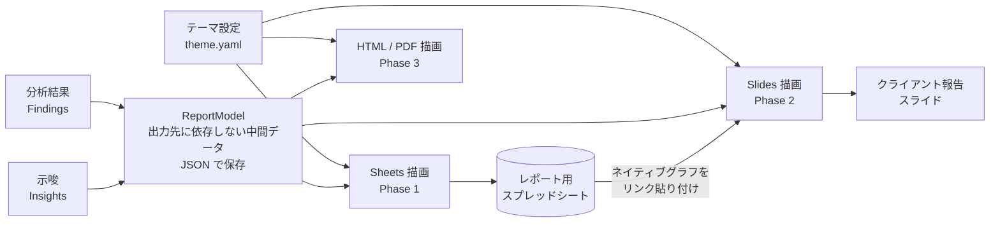

# 04. レポート出力設計（スプレッドシート → スライド展開）

## 1. 方針

- 社内での確認・運用は **Google スプレッドシート** で行う
- クライアント報告用の **スライド** を後から自動生成できるよう、レポートの「中身」と「見せ方」を分ける
- 見た目（色・フォント・ロゴ・グラフの形）は **テーマ設定ファイル** にまとめ、全出力先で共通に使う

## 2. 構成



ReportModel を一度作れば、出力先（Renderer）を足すだけで新しい形式に対応できる。

## 3. ReportModel（中間データ）

```python
class ReportModel(BaseModel):
    report_type: Literal["weekly", "monthly"]
    client_id: str
    period: tuple[date, date]
    compare_period: tuple[date, date]
    headline: list[str]                 # 結論 3 行
    kpi_tiles: list[KpiTile]            # 大きな数字のカード
    charts: list[ChartSpec]             # グラフ定義（データ＋種類）
    tables: list[TableSpec]             # 明細表
    insights: list[Insight]             # 示唆（03 の定義）
    notes: list[str]                    # 注意事項（異常・計測不備）
    audience: Literal["internal", "client"]  # 社内向け / クライアント向け

class KpiTile(BaseModel):
    label: str            # "表示回数"
    value: float
    unit: str             # "回", "円", "%"
    delta_pct: float | None
    target: float | None
    good_direction: Literal["up", "down"]  # CPA は down が良い

class ChartSpec(BaseModel):
    id: str               # "kpi_trend_weekly"
    kind: Literal["line", "bar", "stacked_bar", "waterfall", "pie", "combo"]
    title: str
    data: TableSpec
    x: str
    series: list[str]
```

## 4. スプレッドシート出力（Phase 1）

### 4.1 ファイル構成

| ファイル                                              | 用途                               | 共有範囲                               |
| ----------------------------------------------------- | ---------------------------------- | -------------------------------------- |
| データ用スプレッドシート                              | 取得データ（raw / mart）、実行ログ | 社内のみ                               |
| レポート用スプレッドシート（クライアントごとに 1 つ） | 週次・月次レポート                 | 社内（必要ならクライアントに閲覧共有） |

### 4.2 レポート用スプレッドシートのタブ

| タブ             | 内容                                                                                                        |
| ---------------- | ----------------------------------------------------------------------------------------------------------- |
| サマリ           | 結論 3 行、KPI タイル（表示回数・クリック・CTR・費用・CV・CPA・ROAS・セッション）、前週比・目標比を色で表示 |
| KPI 推移         | 週次 / 日次の推移表 ＋ ネイティブグラフ（折れ線・棒）                                                       |
| 変化要因         | 寄与度分解の表 ＋ ウォーターフォール図                                                                      |
| キャンペーン明細 | キャンペーン別の全指標（条件付き書式で良し悪しを色分け）                                                    |
| 無駄・機会       | 無駄な費用リスト、機会リスト                                                                                |
| 示唆             | 優先度順の示唆（事実・仮説・打ち手・期待効果・確度・根拠）                                                  |
| 示唆ログ         | 過去の示唆とステータス（プルダウン: 未対応 / 実行済み / 却下）、効果測定結果                                |
| _chart_data      | グラフ用のデータ（非表示タブ）                                                                              |

### 4.3 スライドに展開しやすくするための作り方

1. **グラフはスプレッドシートのネイティブグラフで作る**: Google スライドへ「リンク付き」で貼り付けでき、スプレッドシートを更新すればスライド側も更新できる
2. **グラフ 1 つ = 1 つの範囲**: グラフの元データを `_chart_data` タブの固定範囲（名前付き範囲）に置き、毎回同じ場所を上書きする。グラフの ID が変わらないので、スライドとのリンクが切れない
3. **KPI タイルは名前付き範囲**（例: `kpi_impressions`）で持ち、スライドのテキストに差し込めるようにする

## 5. スライド出力（Phase 2）

- **テンプレート方式**: デザイン済みのスライド（表紙、サマリ、KPI 推移、変化要因、示唆、次のアクション）を 1 つ用意し、毎回コピーして中身を差し込む
- 差し込み方法（Google Slides API）:
    - テキスト: `{{kpi_impressions}}` などのプレースホルダを `replaceAllText` で置換
    - グラフ: スプレッドシートのグラフを `createSheetsChart`（リンク付き）で挿入、または画像で差し替え
    - 示唆: 上位 3 件を 1 枚ずつ（クライアント向けは社内メモを除く）
- **クライアント向けフィルタ**: ReportModel の `audience="client"` のとき、社内向けの項目（内部メモ、マージン、確度「低」の示唆など）を除外する。何を出すかはクライアント設定で決める

## 6. テーマ設定（theme.yaml の例）

```yaml
brand:
    name: 'サンプル株式会社'
    logo_path: assets/logo.png
colors:
    primary: '#1F4E79'
    accent: '#F28C28'
    good: '#2E7D32' # 改善
    bad: '#C62828' # 悪化
    neutral: '#757575'
    series: ['#1F4E79', '#F28C28', '#4E9A06', '#8E44AD', '#16A085']
fonts:
    heading: 'Noto Sans JP'
    body: 'Noto Sans JP'
number_format:
    currency: '¥#,##0'
    percent: '0.0%'
    count: '#,##0'
```

テーマはクライアントごとに上書きできる（`clients/<client_id>/theme.yaml`）。

## 7. 将来の拡張

| 拡張                      | 方法                                                               |
| ------------------------- | ------------------------------------------------------------------ |
| PowerPoint（.pptx）で納品 | Slides から書き出し、または python-pptx の Renderer を追加         |
| PDF                       | Slides から PDF 書き出し                                           |
| Looker Studio             | データ用スプレッドシートをデータソースにして接続（コード変更なし） |
